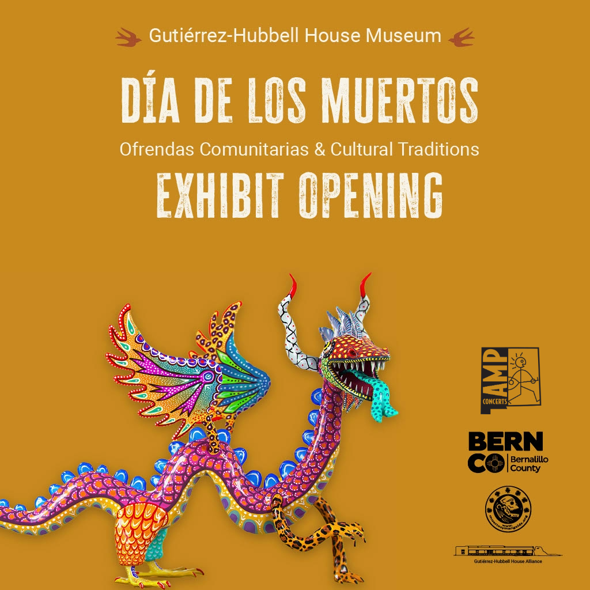
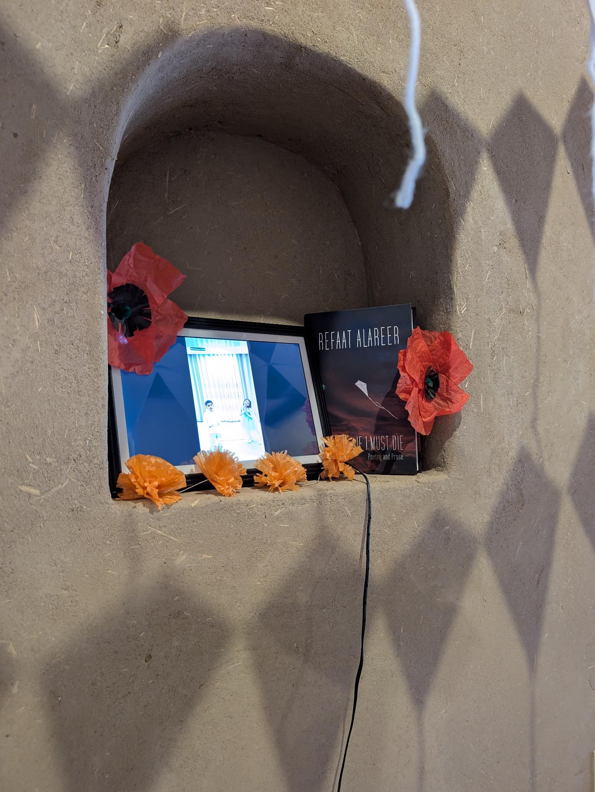
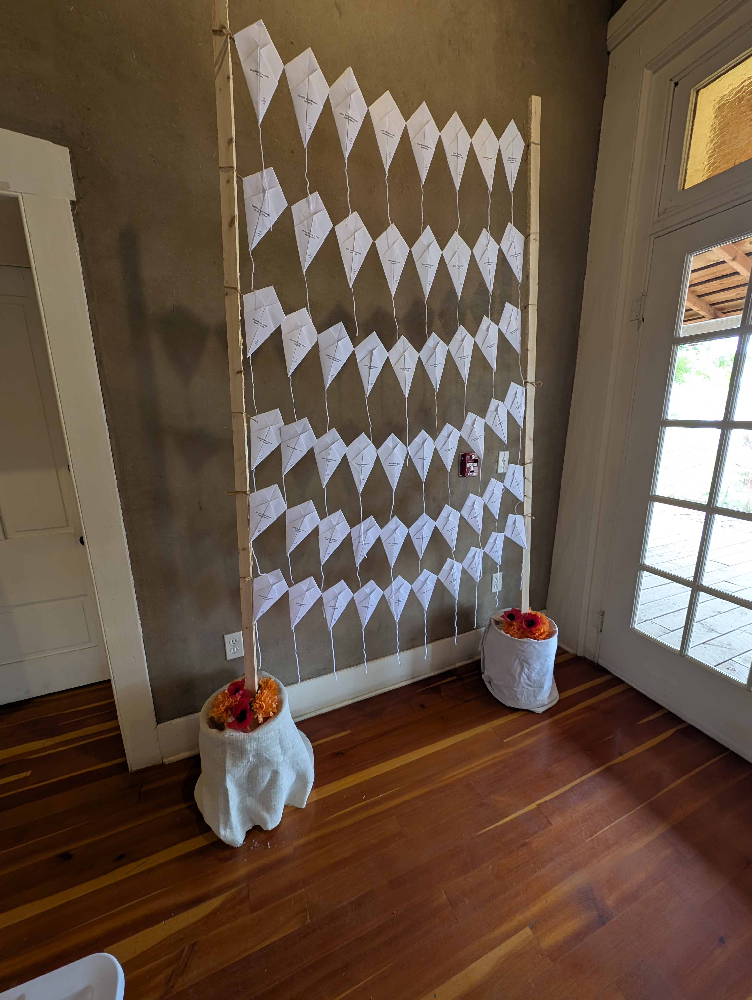
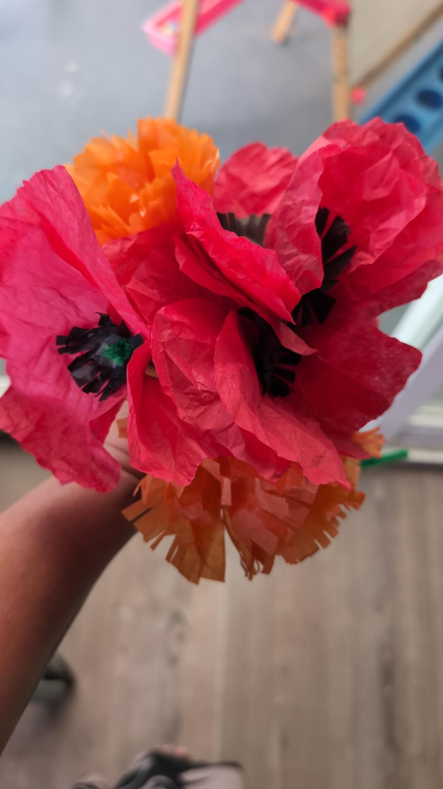
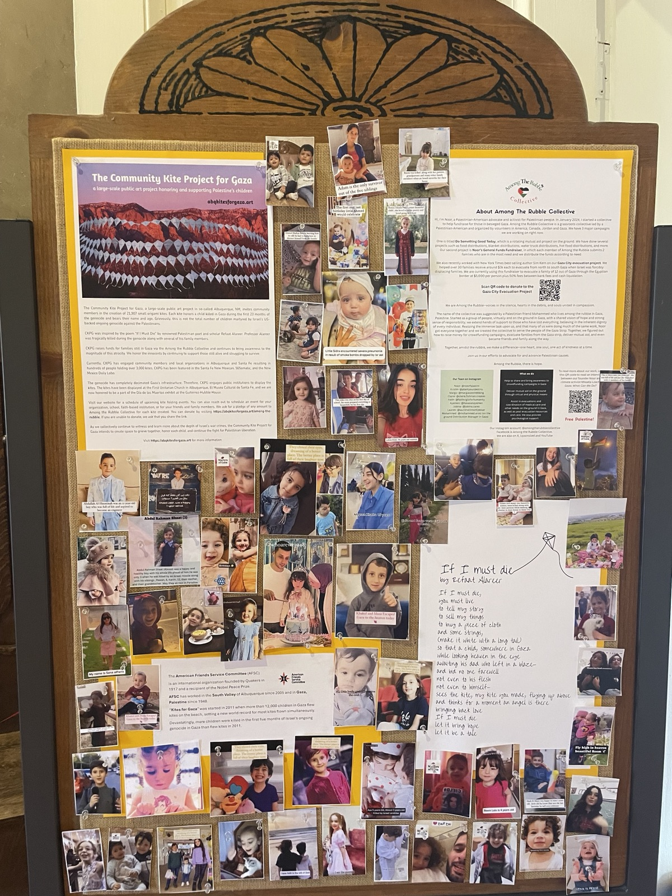

I'm honored and grateful to be able to display some of the kites at the historic Guitérrez-Hubble House during their annual Día de los Muertos exhibit. This installation displays about 250 kites and includes a running video and printed photographs of some of the children while they were still alive. This installation is in collaboration with <a href='https://www.instagram.com/amongtherubblecollective'>Among the Rubble Collective</a> and <a href='https://afsc.org/programs/new-mexico-people-land'>American Friends Service Committee New Mexico</a>. The installation will be up through November 7, 2026

We continue to work with Among the Rubble Collective to help them raise funds for families in Gaza. Among the Rubble is currently trying to evacuate a family of 12 while the border crossing is open. <strong>We are at 73% of the goal. Help us reach 100%!</strong>

<button class='donation-btn'><a href='https://chuffed.org/project/gaza-city-evacuation' target='_blank'>Visit the Campaign</a></button>

