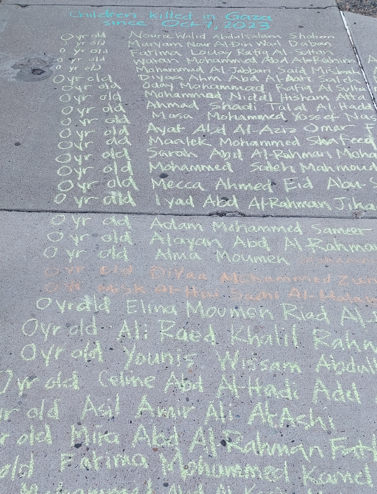
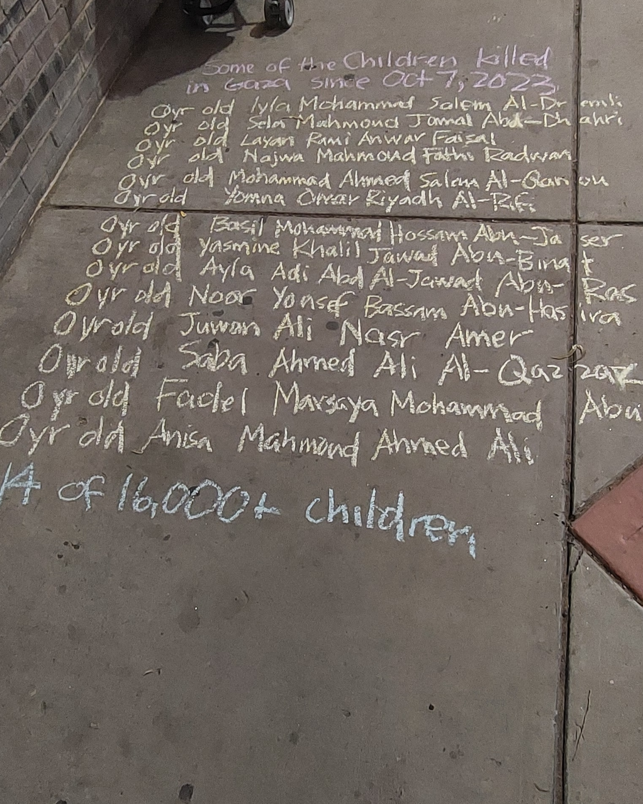
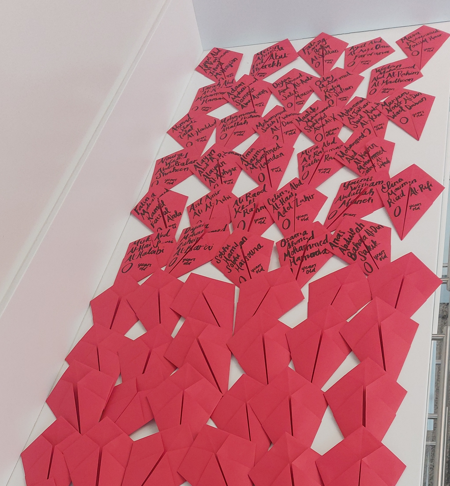

The artist of CKPG, Sarah Ruth Finkel, started this project by taking a list of names and writing the child's name and age in chalk on the sidewalk in Albuqerque, NM. 

  
  

During this art event, dozens of passersby talked with the artist and shared their support of Palestine. One woman gave me a hug and cried. Another woman took chalk and got her nice outfit dirty by getting on the sidewalk with me and helped write the names and ages

Inspired by Refaat Alareer's poem "If I Must Die", Sarah Ruth decided to start working on origami paper kites, one for each child.
.

Originally, the kites were folded in red to signify the red line. After conversations with a local Palestinian-American community organizer, it was agreed upon that white was more appropriate to honor the children.

After realizing that it would take more than her entire life to handwrite all the names, she decided to work with a friend who ran a print shop on printing the names on the kites. It took some time to get the template just right so that when people are folding the kites, the name would link up.

Since this time, hundreds of people in Albuquerque and some in Santa Fe have helped to fold over 3,000 kites. 
