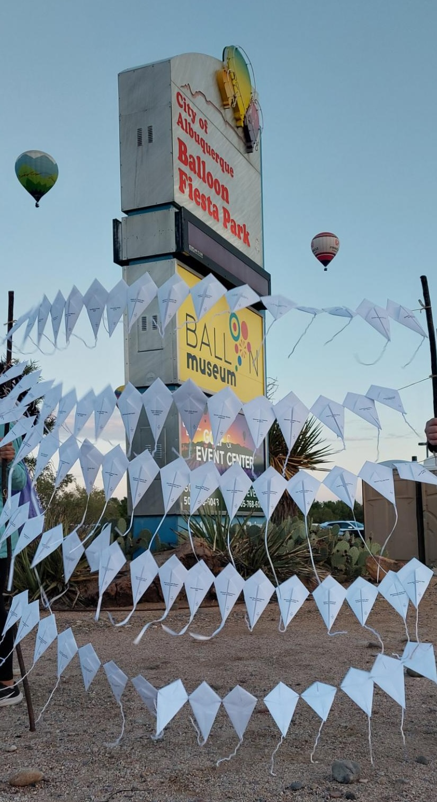
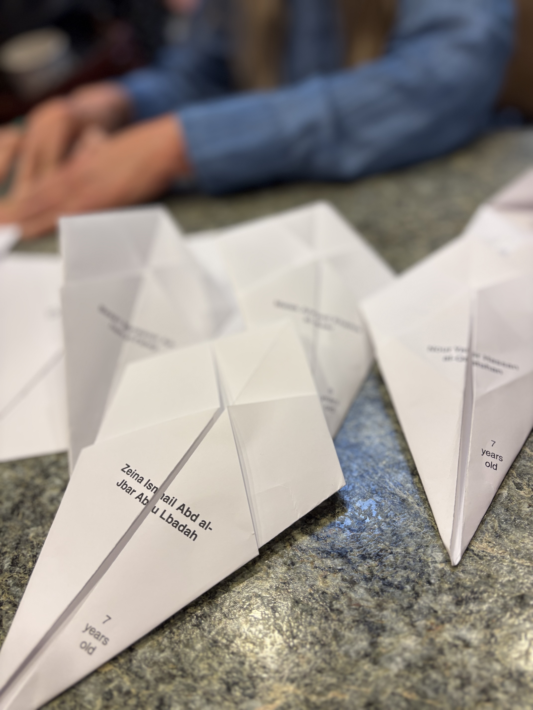
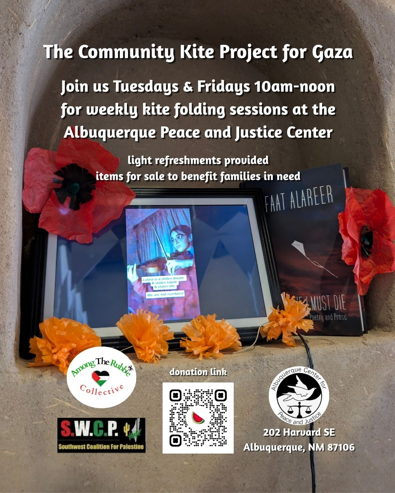

Sarah Ruth Finkel, the main artist behind The Community Kite Project for Gaza, is not Palestinian but does partner with <a href='https://www.instagram.com/amongtherubblecollective'>Among the Rubble Collective</a> and <a href='https://www.instagram.com/swc4palestine'>Southwest Coalition for Palestine</a> - two local, Palestinian-led organizations. These partnerships are imperative to ensure Palestinian voices are leading the conversation for Palestinian liberation.

CKPG began by taking a list of names and writing the child's name and age in chalk on the sidewalk in Albuqerque, NM during the well-attended Art Walk in June of 2025. After witnessing the genocide online for two years, it was a way for this artist to talk about Palestine within the local art community as the call was being made from Gaza to not look away.

  
  

During this art event, dozens of passersby talked with the artist and shared their support of Palestine. One woman gave me a hug and cried. Another woman took chalk and got her nice, clean outfit dirty by getting on the sidewalk with Sarah Ruth writing the names and ages with her.

Inspired by Refaat Alareer's poem "If I Must Die", Sarah Ruth decided to start working on origami paper kites, one for each child. [Professor Alareer](_posts/2025-10-31-if-i-must-die.markdown) was a Palestinian poet and scholar.

Originally, the kites were folded in red to signify the red line. After conversations with a local Palestinian-American community organizer, it was agreed upon that white was more appropriate to honor the children.

After realizing that it would take more than her entire life to handwrite all the names, Sarah Ruth decided to work with a friend from <a href='https://neroink.net/'>Nero Ink</a> in Chicago to print the names and ages on the kites. It took many iterations to get the template just right so that when people folded the kites, the name would come together across the kite.

Since this time, hundreds of people in Albuquerque and some in Santa Fe have helped to fold over 3,000 kites. The kites had their initial public display at the [First Unitarian Church of Albuquerque in April 2026](_posts/2026-04-08-Unitarian-Universalist-church-opening.markdown). A little over 1,000 kites were displayed. In July of this year, about 2,000 kites were displayed and 438 folded during the opening at [El Museo Cultural de Santa Fe](_posts/2026-07-02-El-Museo-Cultural.markdown). The most recent display is at the historic [Guitérrez-Hubble House](_posts/2026-09-30-dia-de-los-muertos-at-GHH.markdown) for their annual Día de los Muertos exhibition. <a href='https://www.instagram.com/reel/DfXiiLkhgx3'>About 250 kites were displayed</a>. For November 2026, CKPG will have weekly kite folding sessions at the <a href='https://www.abqpeaceandjustice.org'>Albuquerque Peace and Justice Center</a> on Tuesdays and Fridays 10am-noon.

The project has been taken to schools (5th graders to high school), people's homes, various community events. It continues to grow simply because of the outpouring of support from so many individuals believing in their hearts what a Free Palestine means for the entire world. 